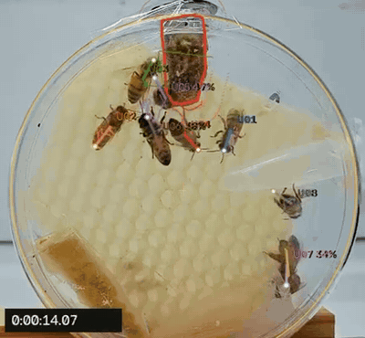
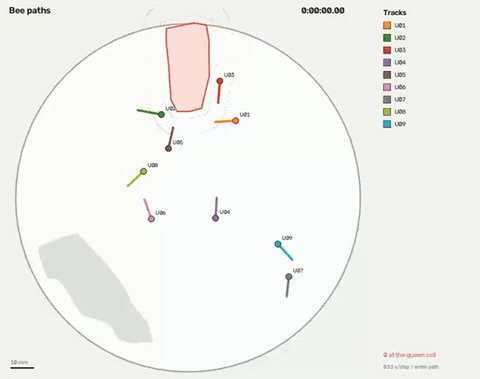
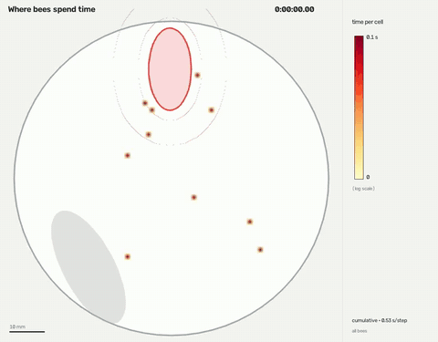

<div align="center">

# 🐝 beetrack

**Which worker visits the queen cell, how often, and for how long?**

Track every bee in a petri-dish arena, tell the bees apart by their paint marks,
and measure their visits to the queen cell, from an ordinary video. No GPU, no training data.



<table>
  <tr>
    <td></td>
    <td></td>
  </tr>
  <tr>
    <td align="center"><b>Paths</b>: each bee on a map of the dish</td>
    <td align="center"><b>Where bees spend time</b>: the queen cell is outlined in red</td>
  </tr>
</table>

</div>

## What you get

- **Every bee, every frame**: position in millimetres, heading, speed, and how sure the identity is.
- **Queen-cell visits**: who visited, when, for how long (contact and vicinity zones).
- **Per-bee summaries**: number of visits, time at the cell, first visit, distance walked.
- **Result videos**: the annotated recording, a paths map and a heatmap, plus CSV / MOT exports.
- **A web app** to upload videos, mark the queen cell, learn the paint colours, run the analysis and explore results.

## Quick start

```bash
git clone https://github.com/yair-hamo/beetrack.git && cd beetrack
python3 -m venv .venv && source .venv/bin/activate
pip install -e .

beetrack synth demo/ --duration 60    # make a test video (with exact ground truth)
beetrack serve                        # open http://localhost:8000
```

Requires Python 3.10+. [ffmpeg](https://ffmpeg.org) is recommended (`brew install ffmpeg`) so result videos play everywhere.

## How to use it

1. **New experiment** → upload your video (several 1-hour segments are fine).
2. **Setup**
   - check the dish circle (found automatically);
   - pick **⬭ Queen cell** and drag across the cell to outline it; draw **▨ Ignore areas** over food or water;
   - enter **Bees in the dish**;
   - click **✦ Find the marks in the video**, tick the real paint marks and give each a bee;
   - **Save**.
3. **Analysis** → **Analyse recording** (about 7 minutes per hour of video on a Mac).
4. **Results**: visits, timelines, charts and downloads. **Explorer**: scrub the video with the tracks drawn on.

Prefer the command line? `beetrack analyze video.mp4 -s setup.json -o results/`

## Good to know

- **Light background, camera above or in front, fixed in place.** The bees must look darker than the dish.
- **One distinct colour per bee.** Bright or fluorescent paint works best; marks on both sides help with a vertical dish.
- **The number of bees matters**: with it, beetrack gives exactly that many identities and never invents extra bees.
- Every position comes with an **identity probability**, so uncertain stretches are visible, not hidden.
- Results on real footage have **not been validated by hand yet**; see [docs/VALIDATION.md](docs/VALIDATION.md).

## Learn more

| | |
|---|---|
| [docs/HARDWARE.md](docs/HARDWARE.md) | the rig: camera, lighting, marking, 3D-printed holder, budget |
| [docs/PIPELINE.md](docs/PIPELINE.md) | how detection, identity and visits work |
| [docs/DATA_FORMATS.md](docs/DATA_FORMATS.md) | every output file and column |
| [docs/API.md](docs/API.md) · [docs/SLEAP.md](docs/SLEAP.md) | REST API · deep-learning route |
| [CLAUDE.md](CLAUDE.md) | full developer notes: architecture, design decisions, accuracy, roadmap |

## Development

```bash
pip install -e ".[dev]" && playwright install chromium
pytest                    # 173 tests, including the web app in a real browser
```

Changes go through a branch and a pull request.

## License

MIT
