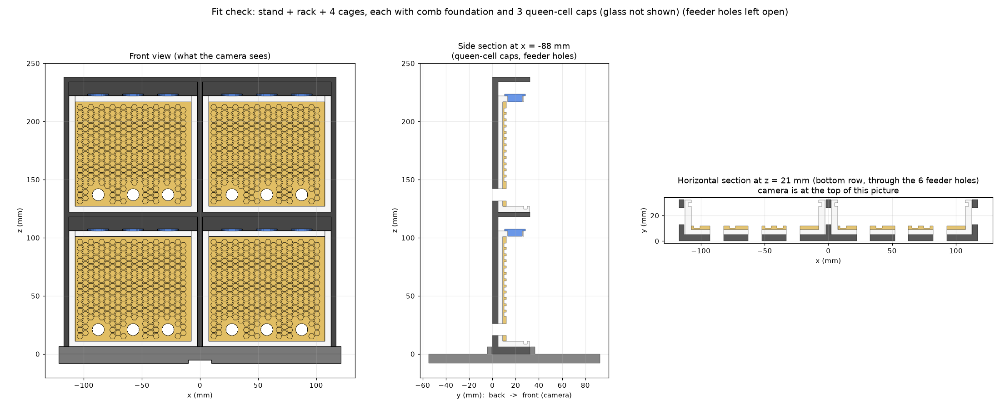

# Bee cages and rack

Four white cages, each holding **exactly 10 marked workers** and up to **3 queen cells**, standing in one rack
so a single camera can film all four at once. This folder covers what is being built now: **the cages, the
rack and its stand**. The camera and light come later (see the end of this page).

- **What to print:** [`cages/stl/`](cages/stl/), made by [`cages/cages.py`](cages/cages.py).
- **Fit check:** [`cages/check/`](cages/check/): every part assembled together and tested (see below).
- **What to buy:** [SHOPPING_LIST.md](SHOPPING_LIST.md).



## One cage

| | Size |
|---|---|
| Outside | **110 × 100 × 27 mm** (width × height × depth) |
| Room for the bees | 100 × 90 mm, **15 mm deep** from the cell tops to the glass (18 mm from the back wall) |
| Glass to order | **104 × 97 × 2 mm**, 4 + spares (not printed) |
| Glass route | **3 mm** wide, like the cages already in use: 2 mm glass + 1 mm play |

- **White PETG body**, printed back-wall-down, no supports.
- **3 feeder holes, Ø 10.5 mm**, in the back wall, low (centres 10 mm above the floor, at −30 / 0 / +30 mm):
  candy, water, pollen. They stay open.
- **3 queen-cell holes, Ø 13 mm**, in the top wall, above the same three positions. The queen-cell
  holder (the blue cup with a disc and a small peg) drops in from above; its disc rests on the top and sticks
  out about 8 mm.
- **Glass cover slides in from the top**: down through a 3 mm slot in the top wall into grooves in the left,
  right and bottom walls. Its top edge ends **flush with the top of the cage**. The front is open at the top,
  so you push the glass up with a thumb on its face.
- **The queen-cell holders and caps lock the glass.** In a cage this shallow their discs (22 mm and 18 mm)
  reach over the glass slot and rest across the glass edge. So: **glass in first, then the holders/caps; to
  open, take the holders/caps out first, then slide the glass up.** The check tests both.
- **Comb foundation** (`foundation.stl`, printed separately): a 99.7 × 89.7 mm sheet, 1 mm thick, with
  worker-sized hexagonal cells (5.4 mm) whose walls stand **2 mm** above it (0.8 mm thick), 3 mm in total.
  Change `CELL_H` / `CELL_WALL` for deeper or bolder cells. It lies against the inside of the back wall and
  goes in and out through the front when the glass is off. Its 3 holes line up with the feeder holes, so
  feeder tubes go through it. The sheet is whole: the queen cells hang just in front of it.
  - **It is a press fit, so it can't fall forward.** The sheet has only 0.15 mm of gap to the walls, and
    14 small round ribs (Ø 1.6 mm) on its edges (3 on each side, 4 on the bottom and 4 on the top) stick out
    0.3 mm, so each presses 0.15 mm into the wall. Push it in flat with your thumbs until it touches the back wall:
    the ribs squash a little and grip. Tapered rib ends help it start; to take it out, lever it at a feeder hole.
  - Too tight: set `RIB_PRESS` to 0.05–0.1. Still loose: 0.25. Then reprint only the foundation; the cage
    doesn't change.
  - **Its 3 holes are exactly the cage's feeder holes: Ø 10.5 mm, same centres.** The ribs keep the sheet
    centred, so the holes line up; the check measures both from the parts and compares them.
- **Queen-cell caps** (`qc_cap.stl`): close any queen-cell hole you don't use. 3 per cage. A flat plug that
  sticks out only 1.6 mm; a small groove under one edge of its rim lets you lift it out with a screwdriver tip.
- **Vents**: 23 horizontal slits per side, 1.8 mm high (bees can't pass), with 1.8 mm bars between them, over
  the whole height of both side walls. The rack walls beside them are open too.
- **2 round sockets** (Ø 10.3 × 2.2 mm) in the back of the cage, at the upper corners: the rack's pegs go
  in them, so every cage sits in exactly the same place.

### How shallow it can be: the queen cells decide

The cage is made **as shallow as the queen-cell holders allow**, so bees can't turn over inside:

- Each queen cell hangs **1 mm in front of the foundation cells** (the sheet stays whole) and **1 mm behind
  the glass**. With the 13 mm holes that gives **15 mm from the cell tops to the glass** (18 mm from the back
  wall).
- The holders' 22 mm discs are wider than the bee room, so they cover the glass slot: that is why the glass
  has to come out after them (above). Letting the glass out with holders in place would need about 20 mm of
  bee room (the first design).
- The discs still fit on the top of the cage, 3.5 mm from its back edge, clear of the rack.

**Measure your holders** (tube and disc) and the length of a hanging queen cell, then set `QC_D`,
`QC_FLANGE_D` and `QC_CELL_LEN` in `cages.py` and run it again. The depth follows automatically
(`QC_COMB_GAP` and `QC_GLASS_GAP` set the 1 mm gaps).

## The rack and the stand

- **Rack** (`rack.stl`, 234 × 238 × 32.5 mm): 2 × 2 **separate pockets**, each with a floor, a wall on each side,
  a back wall and **12 mm of space above the cage** for the queen-cell holders (4 mm to spare). A cage with its
  queen cells in place slides straight in from the front; at the back, **2 pegs** go into the cage's sockets.
  The cage sits on the pocket floor between the pocket walls; nothing to glue.
  - **The pegs press-fit, so a cage can't slide or fall out on its own.** Each peg is a Ø 10 × 2 mm core
    (0.15 mm gap in the Ø 10.3 socket) with **6 small ribs** that press 0.15 mm into the socket wall. Push the
    cage in until it touches the back wall; to take it out, pull it straight forward. The pegs also fix it
    left/right and up/down, so every cage sits in exactly the same place.
  - Too tight: set `PEG_PRESS` to 0.05–0.1. Too loose: 0.25. Then reprint only the rack; the cages don't change.
  - **The holes in the back wall are exactly the cage's feeder holes: Ø 10.5 mm, same centres**, so
    **feeders are pushed in and refilled from behind**, through the rack, the cage and the foundation in one
    straight line.
  - Windows in the walls beside each cage's vents, over their whole height, let air through.
  - The fronts of the cages are flush with the front of the rack, all 4 glasses in one plane.
- **Stand** (`stand.stl`, 243 × 148 mm): the rack drops into a rim and is fixed with **2 countersunk
  M5 × 12 screws** down through the floors of the lower pockets. Their heads sit flush, so the cages slide over
  them. The nuts go into hexagonal pockets under the stand.
  - **On a table:** the stand reaches 55 mm behind and 60 mm in front of the rack, so it won't tip unless
    tilted past about 25°. Four shallow recesses underneath take 10 mm stick-on rubber feet.
  - **On a rail (for the camera, later):** underneath is a groove that fits a **2020 aluminium profile**
    running towards the camera, with **2 M5 holes for T-nuts**. Bolt the stand and the camera to the same
    profile, and the camera distance is fixed and repeatable. Reference: the front face of the glass is
    **37 mm behind the stand's front M5 hole**, so measure the camera distance from that hole.

Order of work with a cage: foundation in; glass down from the top; bees in (through a queen-cell hole, or
with the glass part-way up); queen-cell holders and caps in; slide the cage into its pocket; push the feeders
in from behind. To open it: cage out of the rack, holders and caps out, glass up.

## The fit check

```bash
pip install manifold3d trimesh numpy scipy matplotlib
python hardware/cages/cages.py check
```

This writes every STL, builds the **whole assembly** of printed parts (stand, rack, 4 cages, each with its
foundation and 3 caps, the rack's pegs in the cage sockets; only the feeder holes left open; the glass is left out because it isn't
printed, but the check still tests it), and tests it:

- every part is one closed solid (nothing loose or floating) and fits the P2S bed (256 × 256 × 256 mm);
- **no two of the 22 parts overlap** (the ribs on the foundation and the pegs are counted as squashed, as when fitted);
- the rack's pegs press-fit the cage sockets: only their ribs touch, 0.15 mm deep, so the cages can't slide out;
- the holes in the rack, the cage and the foundation are **exactly the same size, on the same centres** (measured from the parts);
- all 12 feeder holes are open in a straight line (a 10.45 mm tube) from behind the rack, through the rack, the cage and the
  foundation, into the bees;
- the queen-cell holders fit their holes, miss the foundation and the glass, the glass slides up and out once they are
  removed, and **with them in place the glass is held down**;
- the glass fits its grooves; the foundation is a press fit (only its ribs touch the walls, 0.15 mm deep), its feeder holes are exactly the cage's (same diameter, same centres), and it goes in and out through the front;
- a cage with 3 queen cells slides into every pocket;
- the stand is stable.

Results: [`check/check_report.txt`](cages/check/check_report.txt), the picture above, and the whole assembly as
[`check/assembly.stl`](cages/check/assembly.stl) (opens in GitHub's 3D viewer and in Bambu Studio) and
[`check/assembly.glb`](cages/check/assembly.glb) (in colour). If you change any number in `cages.py`, run the
check again; it ends with `ALL CHECKS PASSED` or names what doesn't fit.

## Printing (Bambu Lab P2S, PETG)

| Part | Qty | Colour | How |
|---|---|---|---|
| `cage` | 4 (+1 spare) | white | back wall on the bed (as exported); 0.2 mm layers, 4 walls, 20 % infill; no supports |
| `foundation` | 4 (+1) | white or natural | flat, cells up (as exported); 0.12 mm layers so the cell walls come out clean |
| `qc_cap` | 12 | white | flat top on the bed, stem up (as exported); no supports |
| `rack` | 1 | white or black | back wall on the bed (as exported); 4 walls, 15 % gyroid; no supports |
| `stand` | 1 | any | as exported (rim up) |

PETG, not PLA: PLA softens in a warm bee room. The rack prints on its back, so the pegs point straight up:
no supports.

**Test before printing all of them:** print one cage, one foundation and one cap. Check the glass slides
freely, the holder and the feeder tubes fit their holes, and the cap is snug. Then measure and correct
`GLASS_T`, `QC_FLANGE_D`, `FEED_D` or `CAP_STEM_D` in `cages.py` if needed, and run the check again.

## Later: camera and light (not being built now)

The plan stays as before: one colour industrial camera (Hikrobot MV-CS050-10UC, 5 MP) with a 12 mm lens about
42 cm in front of the glass. That gives about 8 px/mm, so a 2–3 mm paint dot is 16–24 pixels wide. Add
constant LED light (CRI ≥ 90) with cross-polarisation against glass reflections, and software that crops the
4 cages live into 4 videos and analyses them while the run goes on. The camera will mount on the same 2020
profile as the stand. The camera and light parts will be designed when that stage starts.
